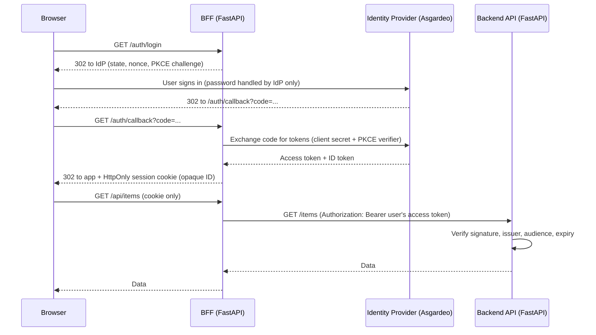
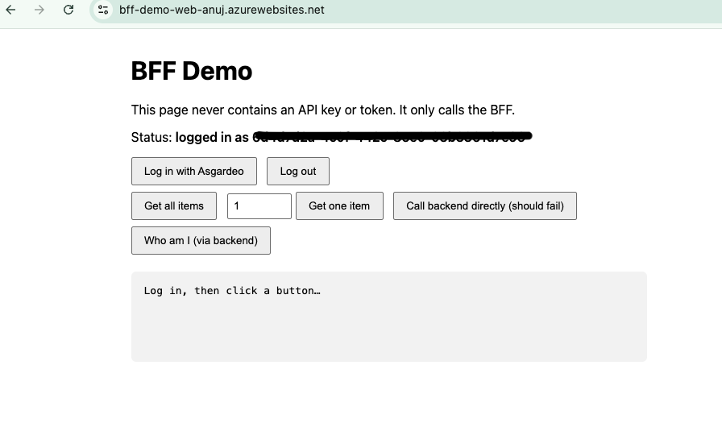
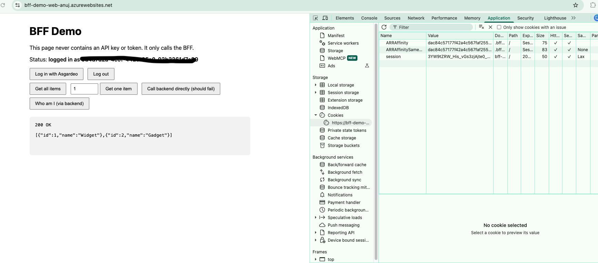
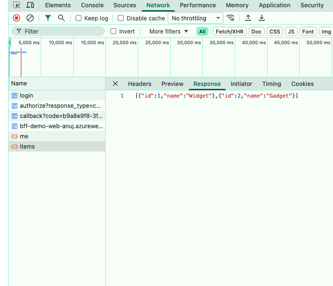
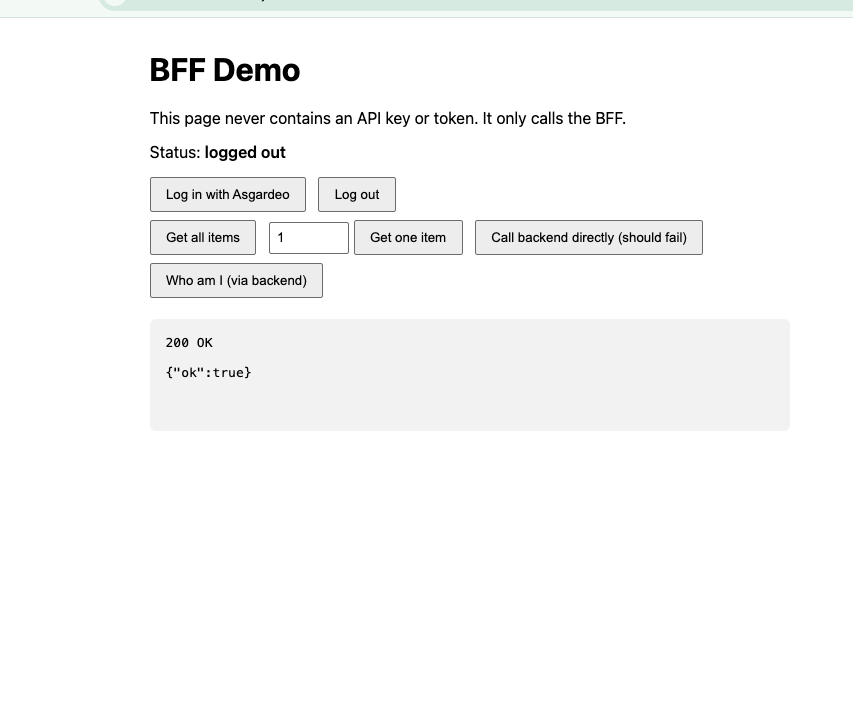

# Secure BFF Reference Architecture

A small, working reference implementation of the **Backend-for-Frontend (BFF)** pattern in Python/FastAPI, deployed on **Azure App Service**. A browser app signs users in through an OpenID Connect identity provider (Asgardeo), and **no token or API credential ever reaches the browser**. The backend API accepts only IdP-signed tokens, so it knows which user is calling.

> Personal learning project. It is a reference implementation, not production software. See [Limitations](#limitations).

## Architecture



| Component | Role |
|---|---|
| **BFF** (`bff.py`) | Confidential OIDC client. Runs the login flow, stores tokens server-side, issues a session cookie, proxies API calls, and serves the static frontend from the same origin. |
| **Frontend** (`frontend/index.html`) | Static page served by the BFF. Calls only the BFF. Contains no secrets. |
| **Backend API** (`backend.py`) | Resource server. Validates the bearer token's signature and claims against the IdP's public keys. No shared secret. |
| **Identity provider** | Asgardeo (OIDC). Owns user accounts and passwords. |

Serving the frontend from the BFF keeps the page and the API on one origin, so the session cookie stays first-party and no cross-origin cookie handling is needed.

## Security controls

| Control | Where | What it prevents |
|---|---|---|
| Authorization code flow + PKCE, `state`, `nonce` | BFF / IdP | Code interception, login CSRF, token replay |
| Tokens stored server-side; browser gets an opaque session ID | BFF | Token theft via XSS |
| `HttpOnly`, `Secure`, `SameSite=Lax` cookie, 15-minute TTL | BFF | JavaScript access to the session, cross-site sending, long-lived sessions |
| JWT validation (signature, issuer, audience, expiry) | Backend | Forged, foreign, or expired tokens |
| Per-user bearer token instead of a shared API key | BFF to Backend | Shared-secret leakage; lets the backend identify the caller |
| CORS allowlist (single origin) | BFF | Other websites calling the BFF from a visitor's browser |
| Input validation (typed, range-limited path params) | BFF | Malformed input reaching the backend |
| Per-IP rate limiting | BFF | Simple abuse and brute-force attempts |
| Generic upstream errors; no OpenAPI/docs exposed | BFF | Leaking backend details and API surface |

## Screenshots

## Screenshots

**Logged in through Asgardeo, data returned via the BFF (live on Azure)**


**The `session` cookie is HttpOnly and Secure, so JavaScript cannot read it**


**Login flow in the Network tab: BFF redirects to the IdP, the IdP returns a one-time code to the BFF callback, then the API calls succeed**


**After logout the session is gone and the status returns to logged out**


## Run it locally

**Prerequisites:** Python 3.10+, and a free [Asgardeo](https://wso2.com/asgardeo/) organization.

### 1. Register an app in Asgardeo
- Applications, New Application, **Traditional Web Application**, protocol **OpenID Connect**.
- Authorized redirect URL: `http://localhost:8000/auth/callback` (add your deployed callback URL here later).
- Protocol tab: enable the **Code** grant; set the **Access Token type to JWT**.
- Create a test user.

### 2. Install
```bash
python3 -m venv .venv
source .venv/bin/activate          # Windows: .venv\Scripts\activate
pip install -r requirements.txt
```

### 3. Configure
```bash
cp .env.example .env
```
Fill in `.env` (never commit it). Get `issuer` and `jwks_uri` from your IdP's discovery document.

| Variable | Meaning |
|---|---|
| `OIDC_CLIENT_ID` / `OIDC_CLIENT_SECRET` | From your Asgardeo app |
| `OIDC_DISCOVERY_URL` | `.../.well-known/openid-configuration` |
| `OIDC_ISSUER` | `issuer` value from the discovery document |
| `OIDC_AUDIENCE` | Your client ID |
| `OIDC_JWKS_URL` | `jwks_uri` value from the discovery document |
| `SESSION_SECRET` | Long random string (`python -c "import secrets; print(secrets.token_hex(32))"`) |
| `BACKEND_URL` | Optional. Defaults to `http://localhost:9000` |
| `OIDC_REDIRECT_URI` | Optional. Defaults to `http://localhost:8000/auth/callback` |
| `COOKIE_SECURE` | Optional. Set `true` when served over HTTPS |

### 4. Start the two processes (separate terminals)
```bash
python -m uvicorn backend:app --port 9000 --env-file .env
python -m uvicorn bff:app --port 8000 --env-file .env
```
Open `http://localhost:8000` (use `localhost`, not `127.0.0.1`).

## What to try

1. **Logged out**, click *Get all items*: `401`.
2. **Log in with Asgardeo**: you are redirected to the IdP's login page, then back.
3. *Get all items*: `200`. *Who am I (via backend)*: returns your IdP user ID, proving the backend sees the caller's identity.
4. Open DevTools:
   - **Application, Cookies**: `session` is `HttpOnly` (and `Secure` over HTTPS).
   - **Network**: requests to `/api/*` contain no token or API key.
5. Call the backend directly: `curl -i http://localhost:9000/items` returns `401`.
6. Log out: `/api/*` returns `401` again.

The page also has a "Call backend directly" button, left in as a leftover from development. It points at the local backend port and is not part of the architecture.

## Deploy to Azure App Service

The project runs as two Linux App Service apps (Python) on one shared plan.

1. Create a resource group and an App Service plan (Basic tier worked for this project; check quota in your region).
2. Deploy `backend.py` and its `requirements.txt` as one web app. Deploy `bff.py`, `frontend/`, and its `requirements.txt` as another (`az webapp up` from each folder).
3. Set the start command on each app, for example: `python -m uvicorn bff:app --host 0.0.0.0 --port 8000` (and `backend:app` for the API).
4. Set the environment variables as **App Service application settings**, using the same names as `.env`. For the BFF also set `BACKEND_URL` to the backend's HTTPS address, `OIDC_REDIRECT_URI` to `https://<bff-app>.azurewebsites.net/auth/callback`, `COOKIE_SECURE=true`, and `ALLOWED_ORIGIN` to the BFF's own origin.
5. Add the deployed callback URL to the Asgardeo app's authorized redirect URLs.

Lessons learned: verify that application settings are not blank before saving them (a blank `OIDC_JWKS_URL` crashed the backend at startup), and deploy from clean folders so local files such as `.env` are never uploaded.

## Limitations

This project demonstrates the pattern. Before production use it would need:

- **Secrets in a managed vault.** Secrets are held as App Service application settings; a vault (such as Azure Key Vault, referenced by managed identity) would be better.
- **Network isolation.** The backend rejects unauthenticated calls but is still reachable from the public internet; a deployment should accept traffic only from the BFF (access restrictions or private networking).
- **Persistent shared session store** (e.g. Redis). Sessions are in memory and are lost on restart; this cannot scale past one instance.
- **Distributed rate limiting.** The limiter is in-memory and per-process. Behind a proxy, client IPs must come from a trusted `X-Forwarded-For`.
- **Token refresh.** Access tokens are used until the 15-minute session ends; refresh tokens are stored but not used.
- **Full logout.** Logout ends the BFF session only; the IdP session remains (RP-initiated logout is not implemented).
- **CSRF tokens** for any state-changing endpoints. Today the API is read-only, protected by `SameSite=Lax` and the CORS allowlist.
- **Authorization rules.** The backend authenticates callers but has no per-user data rules yet.
- **Automated tests, audit logging, infrastructure as code, and a CI/CD pipeline.**

## Notes on the pattern

A BFF is one layer of defense in depth, not a complete security boundary. It keeps credentials out of the browser; user authentication, backend authorization, and network isolation are still required.