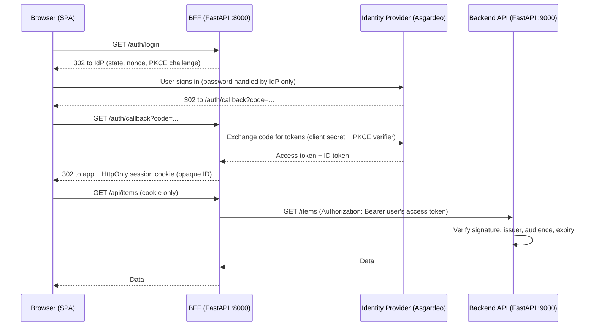

# Secure BFF Reference Architecture

A small, working reference implementation of the **Backend-for-Frontend (BFF)** pattern in Python/FastAPI. A browser app signs users in through an OpenID Connect identity provider (Asgardeo), and **no token or API credential ever reaches the browser**. The backend API accepts only IdP-signed tokens, so it knows which user is calling.

> Personal learning project, run locally. It is a reference implementation, not production software. See [Limitations](#limitations).

## Architecture



| Component | Role |
|---|---|
| **Frontend** (`frontend/index.html`) | Static page. Calls only the BFF. Contains no secrets. |
| **BFF** (`bff.py`) | Confidential OIDC client. Runs the login flow, stores tokens server-side, issues a session cookie, proxies API calls. |
| **Backend API** (`backend.py`) | Resource server. Validates the bearer token's signature and claims against the IdP's public keys. No shared secret. |
| **Identity provider** | Asgardeo (OIDC). Owns user accounts and passwords. |

## Security controls

| Control | Where | What it prevents |
|---|---|---|
| Authorization code flow + PKCE, `state`, `nonce` | BFF / IdP | Code interception, login CSRF, token replay |
| Tokens stored server-side; browser gets an opaque session ID | BFF | Token theft via XSS |
| `HttpOnly`, `SameSite=Lax`, optional `Secure` cookie, 15-minute TTL | BFF | JavaScript access to the session, cross-site sending, long-lived sessions |
| JWT validation (signature, issuer, audience, expiry) | Backend | Forged, foreign, or expired tokens |
| Per-user bearer token instead of a shared API key | BFF to Backend | Shared-secret leakage; lets the backend identify the caller |
| CORS allowlist (single origin) | BFF | Other websites calling the BFF from a visitor's browser |
| Input validation (typed, range-limited path params) | BFF | Malformed input reaching the backend |
| Per-IP rate limiting | BFF | Simple abuse and brute-force attempts |
| Generic upstream errors; no OpenAPI/docs exposed | BFF | Leaking backend details and API surface |

## Run it locally

**Prerequisites:** Python 3.10+, and a free [Asgardeo](https://wso2.com/asgardeo/) organization.

### 1. Register an app in Asgardeo
- Applications, New Application, **Traditional Web Application**, protocol **OpenID Connect**.
- Authorized redirect URL: `http://localhost:8000/auth/callback`
- Protocol tab: enable the **Code** grant; set the **Access Token type to JWT**.
- Create a test user.

### 2. Install
```bash
python3 -m venv .venv
source .venv/bin/activate          # Windows: .venv\Scripts\activate
pip install -r requirements.txt
```

### 3. Configure
```bash
cp .env.example .env
```
Fill in `.env` (never commit it). Get `issuer` and `jwks_uri` from your IdP's discovery document (`OIDC_DISCOVERY_URL`).

| Variable | Meaning |
|---|---|
| `OIDC_CLIENT_ID` / `OIDC_CLIENT_SECRET` | From your Asgardeo app |
| `OIDC_DISCOVERY_URL` | `.../.well-known/openid-configuration` |
| `OIDC_ISSUER` | `issuer` value from the discovery document |
| `OIDC_AUDIENCE` | Your client ID |
| `OIDC_JWKS_URL` | `jwks_uri` value from the discovery document |
| `SESSION_SECRET` | Long random string (`python -c "import secrets; print(secrets.token_hex(32))"`) |

### 4. Start the three processes (separate terminals)
```bash
python -m uvicorn backend:app --port 9000 --env-file .env
python -m uvicorn bff:app --port 8000 --env-file .env
cd frontend && python3 -m http.server 8080
```
Open `http://localhost:8080` (use `localhost`, not `127.0.0.1`).

## What to try

1. **Logged out**, click *Get all items*: `401`.
2. **Log in with Asgardeo**: you are redirected to the IdP's login page, then back.
3. *Get all items*: `200`. *Who am I (via backend)*: returns your IdP user ID, proving the backend sees the caller's identity.
4. Open DevTools:
   - **Application, Cookies**: `session` is `HttpOnly`.
   - **Network**: requests to `/api/*` contain no token or API key.
5. Call the backend directly: `curl -i http://localhost:9000/items` returns `401`.
6. Log out: `/api/*` returns `401` again.

<!-- Add screenshots here: HttpOnly cookie, Network tab with no token, direct backend call returning 401. -->

## Limitations

This project demonstrates the pattern. Before production use it would need:

- **Persistent shared session store** (e.g. Redis). Sessions are in memory and are lost on restart; this cannot scale past one process.
- **Distributed rate limiting.** The limiter is in-memory and per-process. Behind a proxy or load balancer, client IPs must come from a trusted `X-Forwarded-For`.
- **Token refresh.** Access tokens are used until the 15-minute session ends; refresh tokens are stored but not used.
- **Full logout.** Logout ends the BFF session only; the IdP session remains (RP-initiated logout is not implemented).
- **CSRF tokens** for any state-changing endpoints. Today the API is read-only, protected by `SameSite=Lax` and the CORS allowlist.
- **Network isolation.** Locally the backend is reachable directly on its port (it rejects unauthenticated calls, but is not network-restricted). A deployment should accept traffic only from the BFF.
- **Authorization rules.** The backend authenticates callers but has no per-user data rules yet.
- **HTTPS.** Run with `COOKIE_SECURE=true` behind TLS in any real deployment.
- **Automated tests, audit logging, and secret management** (e.g. a managed vault instead of a `.env` file).

## Possible next steps

Deploy to a cloud platform with the backend reachable only from the BFF, secrets in a managed vault, infrastructure as code, a CI/CD pipeline, Redis-backed sessions, and automated tests.

## Notes on the pattern

A BFF is one layer of defense in depth, not a complete security boundary. It keeps credentials out of the browser; user authentication, backend authorization, and network isolation are still required.
